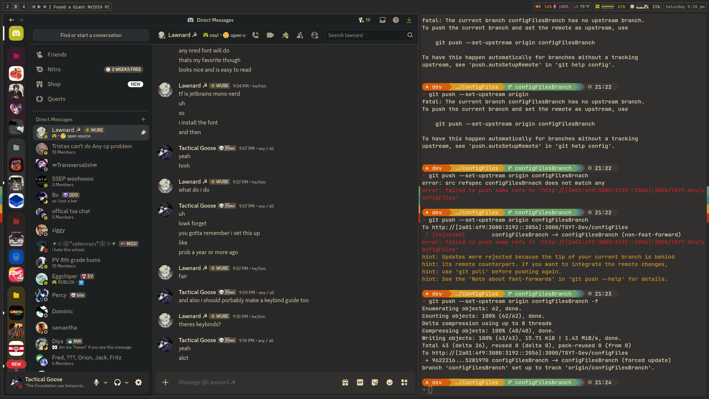
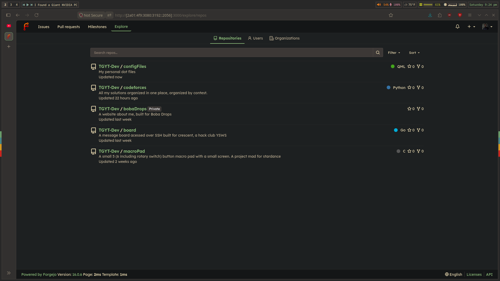
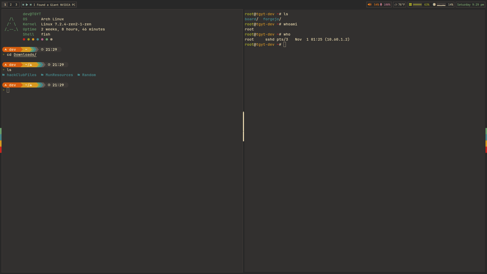

<table width="100%">
  <tr>
    <td width="50%"></td>
    <td width="50%"></td>
  </tr>
  <tr>
    <td width="50%"></td>
    <td width="50%"></td>
  </tr>
</table>

# ~~Corvid's~~Lawnard's Config
This repo will have some oddities left over from when this was hosted on github being my first repo. These are my configs for sway and other applications. These are probably very opioniated as these have been a product of my personal expieriences with arch linux. I may switch to DWM in the future. Everything is themed after Gruvbox Dark Soft.

## Installing 
For whatever reason you may want to intall these do,
```bash
git clone https://github.com/LawrnardKerman/ConfigFiles /tmp/ConfigFiles
cd /tmp/ConfigFiles
sudo pacman -S --needed git sway kitty mako neovim fish starship exa bat rofi grim slurp swappy
yay -S --needed --noconfirm quickshell-git
./install.sh 
```
then 
```bash
sudo reboot
```
 ㅤㅤ

> [!NOTE]
> You need yay for this, or any AUR helper but i like yay the best. You can install yay with the below
> ```bash
> git clone https://aur.archlinux.org/yay.git
> cd yay
> makepkg -si
> ```

## Keybinds

| Shortcut | Action |
|---|---|
| Mod + Return | Open terminal |
| Mod + Shift + Q | Kill focused window |
| Mod + D | App launcher |
| Mod + Shift + D | Run command |
| Mod + Alt + D | Window switcher |
| Mod + Shift + Space | Toggle floating |
| Mod + F | Toggle fullscreen |
| Mod + Shift + C | Reload Sway config |
| Mod + H / J / K / L | Focus left / down / up / right |
| Mod + Shift + H / J / K / L | Move window left / down / up / right |
| Mod + # | Switch to workspace # |
| Mod + Shift + # | Move window to workspace # |
| Mod + Minus | Toggle notes |
| Mod + Escape | Lock screen |
| Alt + Shift + S | Screenshot region |
